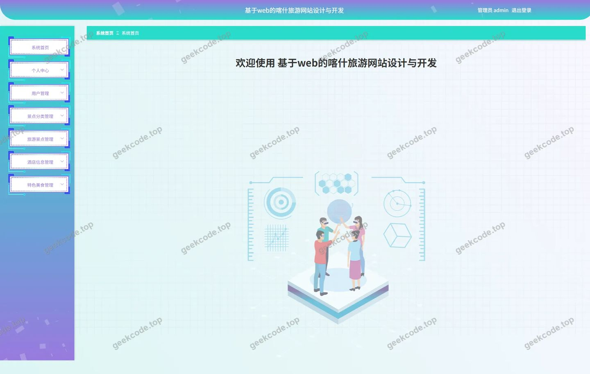
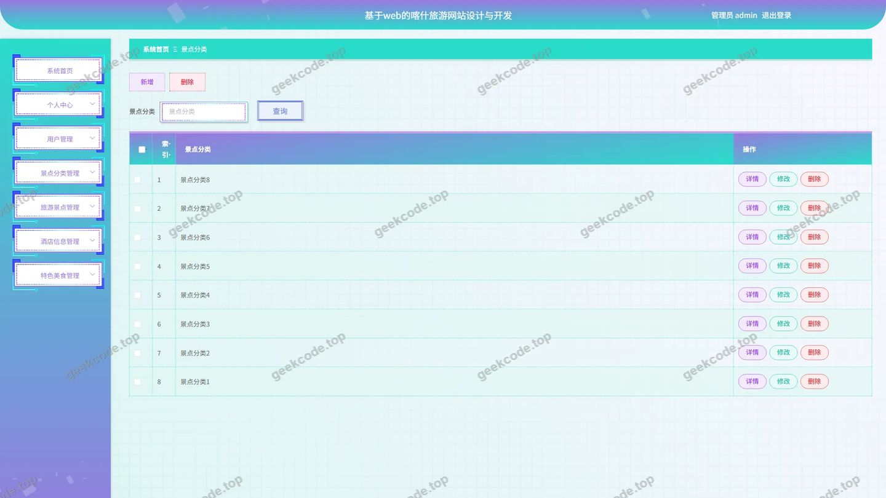
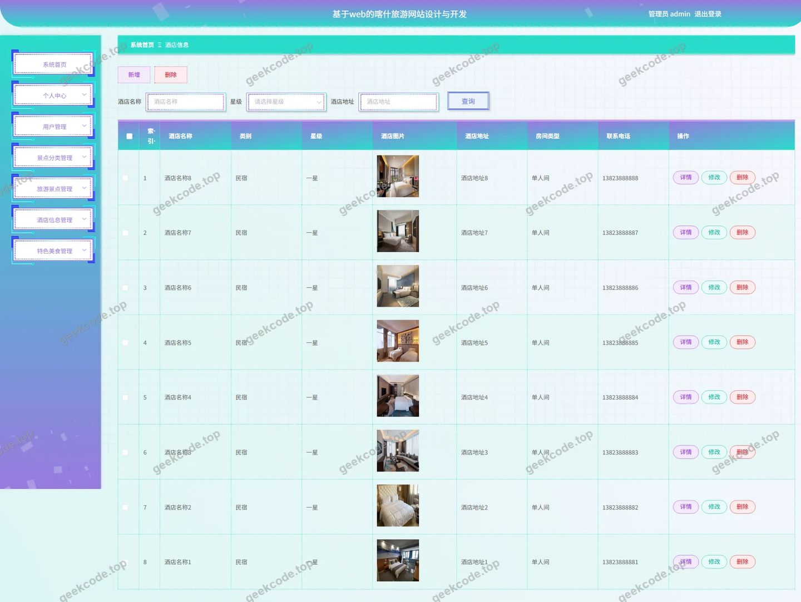
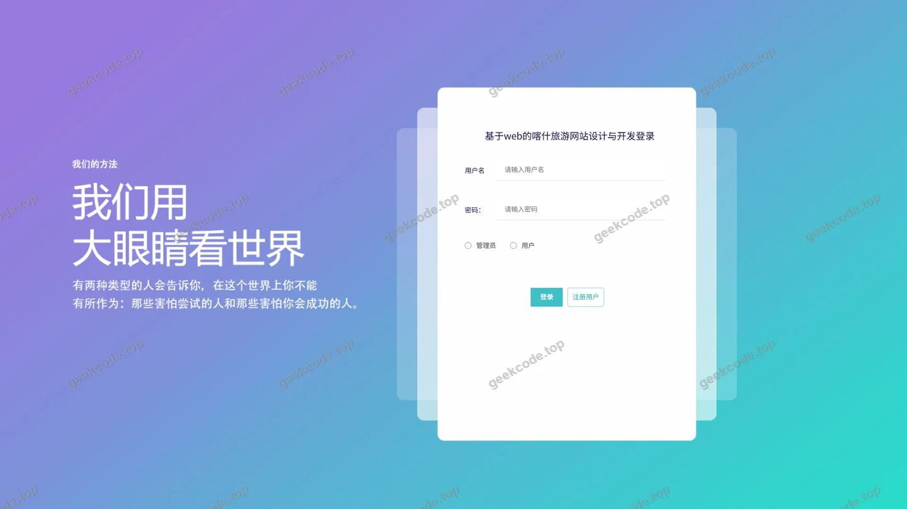
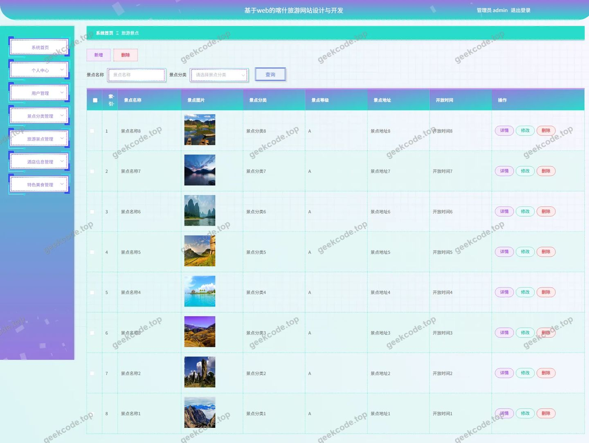
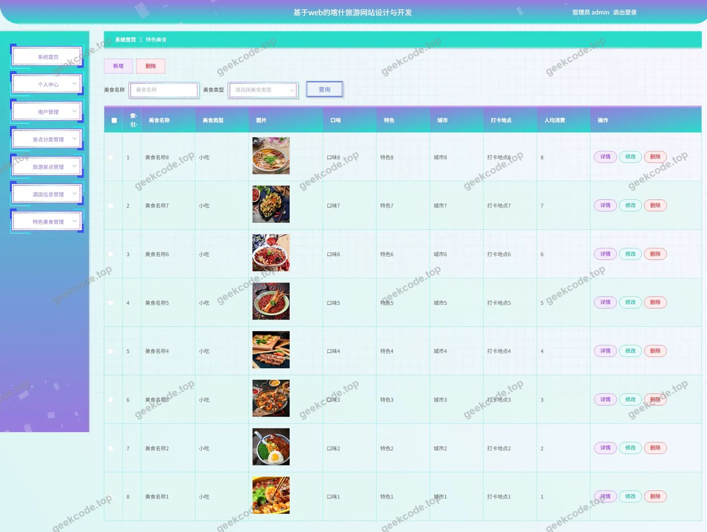

# 基于web的喀什旅游网站设计与开发hw31x

> 🎓 **计算机毕业设计 · 基于web的喀什旅游网站设计与开发hw31x**
>
> 本仓库只放**项目介绍 + 运行截图**（截图是站点带水印的原图，存在仓库 `images/` 里）。
>
> 👉 **完整可运行源码 / 数据库脚本 / 部署文档：[点我获取](https://geekcode.top/archives/%E5%9F%BA%E4%BA%8Eweb%E7%9A%84%E5%96%80%E4%BB%80%E6%97%85%E6%B8%B8%E7%BD%91%E7%AB%99%E8%AE%BE%E8%AE%A1%E4%B8%8E%E5%BC%80%E5%8F%91hw31x?utm_source=github)**
>
> 💬 咨询微信：**ir9372**　|　🌐 更多项目：[极客代码 geekcode.top](https://geekcode.top/?utm_source=github)
>
> 📌 项目详情页：<https://geekcode.top/archives/%E5%9F%BA%E4%BA%8Eweb%E7%9A%84%E5%96%80%E4%BB%80%E6%97%85%E6%B8%B8%E7%BD%91%E7%AB%99%E8%AE%BE%E8%AE%A1%E4%B8%8E%E5%BC%80%E5%8F%91hw31x?utm_source=github>

<table><td width="230" align="center"> <b>扫码加微信 ir9372</b></td><td valign="middle">📦 源码 = 项目介绍 + 全部运行截图 + 数据库 + 部署文档 👉 点上方任意截图，直接跳到 <b>极客代码 geekcode.top</b> 详情页</td></table>

---

<h1>基于web的喀什旅游网站设计与开发_hw31x</h1>
<h2>项目概述</h2>

本项目为“基于web的喀什旅游网站设计与开发_hw31x”，旨在构建一个专注于新疆喀什地区旅游资源管理的后台系统。核心功能涵盖旅游景点、景点分类、特色美食及酒店信息的数字化管理，以及用户账户体系的维护。项目主要面向旅游行业管理人员及平台运营者，适用于区域旅游资源的集中化展示与信息更新场景。技术架构采用 Spring Boot 作为后端框架，结合 MyBatis-Plus 进行数据持久层操作，并利用 Apache Shiro 实现安全认证与权限控制，确保数据访问的安全性与高效性。

<h2>技术架构</h2>
<h3>前后端架构</h3>

本项目采用 Vue 集成模式（vue-integrated），前端界面嵌入于后端应用中，通过统一的入口提供服务。后端基于 Spring Boot 框架构建，利用 <code>spring-boot-starter-web</code> 提供 RESTful API 接口支持。数据交互层使用 MyBatis-Plus 简化 CRUD 操作，提升开发效率。

<h3>数据库设计要点</h3>

数据库选用 MySQL，通过 <code>mysql-connector-java</code> 驱动连接。核心数据表对应后台路由模块，包括：

<ul>
<li><strong>旅游景点表</strong>：存储景点详细信息。</li>
<li><strong>景点分类表</strong>：管理景点的分类标签。</li>
<li><strong>特色美食表</strong>：记录喀什地区的特色餐饮信息。</li>
<li><strong>酒店信息表</strong>：保存住宿设施数据。</li>
<li><strong>用户表</strong>：管理系统注册用户及管理员账号。</li>
</ul>
<h3>核心技术选型理由</h3>
<ul>
<li><strong>Spring Boot</strong>：具备自动配置特性，快速搭建企业级应用，生态成熟。</li>
<li><strong>MyBatis-Plus</strong>：在 MyBatis 基础上增强，无需编写大量 SQL 即可实现复杂查询，适合业务逻辑清晰的 CRUD 场景。</li>
<li><strong>Apache Shiro</strong>：轻量级安全框架，提供强大的认证和授权机制，有效保护后台敏感数据接口，防止未授权访问。</li>
</ul>
<h2>功能模块</h2>

根据现有源码与截图，本项目仅包含后台管理端功能，无前台用户浏览页面。具体模块如下：

<h3>后台管理端</h3>
<ol>
<li><strong>登录模块</strong></li>
</ol>
<ul>
<li>提供管理员身份验证入口，确保只有授权人员可进入系统后台。</li>
</ul>
<ol start="2">
<li><strong>首页仪表盘</strong></li>
</ol>
<ul>
<li>展示系统概览信息，作为管理员进入后的初始视图。</li>
</ul>
<ol start="3">
<li><strong>用户管理 (<code>/yonghu</code>, <code>/UsersController</code>, <code>/YonghuController</code>)</strong></li>
</ol>
<ul>
<li>对系统内的用户信息进行增删改查操作，维护用户基础档案。</li>
</ul>
<ol start="4">
<li><strong>酒店信息管理 (<code>/jiudianxinxi</code>, <code>JiudianxinxiController</code>)</strong></li>
</ol>
<ul>
<li>录入、编辑、删除及查询喀什地区的酒店住宿信息，包括名称、地址等字段。</li>
</ul>
<ol start="5">
<li><strong>特色美食管理 (<code>/tesemeishi</code>, <code>TesemeishiController</code>)</strong></li>
</ol>
<ul>
<li>管理当地特色美食数据，支持对菜品介绍、图片等信息的维护。</li>
</ul>
<ol start="6">
<li><strong>景点分类管理 (<code>/jingdianfenlei</code>, <code>JingdianfenleiController</code>)</strong></li>
</ol>
<ul>
<li>定义和维护旅游景点的分类体系，便于后续对景点进行归类展示。</li>
</ul>
<ol start="7">
<li><strong>旅游景点管理 (<code>/lvyoujingdian</code>, <code>LvyoujingdianController</code>)</strong></li>
</ol>
<ul>
<li>核心业务模块，负责旅游景点的详细资料管理，关联景点分类，支持内容的动态更新。</li>
</ul>
<ol start="8">
<li><strong>通用功能支持</strong></li>
</ol>
<ul>
<li><strong>文件上传 (<code>FileController</code>)</strong>：支持景点图片、美食图片等非结构化数据的上传与管理。</li>
<li><strong>系统配置 (<code>ConfigController</code>)</strong>：管理系统基础参数配置。</li>
<li><strong>关于我们 (<code>AboutusController</code>)</strong>：维护平台简介或联系信息。</li>
</ul>
<h2>用户角色与权限</h2>

根据 Shiro 安全框架及后台路由设计，系统主要涉及以下角色及其权限范围：

<table>
<thead>
<tr>
<th align="left">角色</th>
<th align="left">权限描述</th>
<th align="left">可访问功能模块</th>
</tr>
</thead>
<tbody><tr>
<td align="left"><strong>管理员 (Admin)</strong></td>
<td align="left">拥有最高权限，负责所有业务数据的维护与系统配置。</td>
<td align="left">1. 后台登录页2. 后台首页3. 用户管理4. 酒店信息管理5. 特色美食管理6. 景点分类管理7. 旅游景点管理8. 文件上传管理9. 系统配置管理</td>
</tr>
</tbody></table>

<em>注：根据现有信息，系统未明确展示普通用户的前台注册或登录入口，主要服务于后台管理人员。</em>

<h2>项目特色与创新点</h2>
<ol>
<li><strong>垂直领域深耕</strong>：聚焦于“喀什”这一特定地域的旅游资源整合，相比通用旅游网站，更具针对性和文化特色，有助于推广地方旅游资源。</li>
<li><strong>一体化安全管理</strong>：集成 Apache Shiro 框架，实现了细粒度的权限控制和会话管理，保障了旅游数据和用户隐私的安全性。</li>
<li><strong>高效的数据持久层</strong>：采用 MyBatis-Plus 替代传统 JDBC 手写 SQL，大幅减少了样板代码，提升了开发效率和维护性，使开发者能更专注于业务逻辑的实现。</li>
<li><strong>模块化内容管理</strong>：将景点、分类、美食、酒店分离为独立的管理模块，结构清晰，便于后期扩展新的旅游元素类型。</li>
</ol>
<h2>部署环境</h2>

运行本项目所需的软件环境如下：

<ul>
<li><strong>操作系统</strong>：Windows, Linux 或 macOS</li>
<li><strong>Java 开发工具包 (JDK)</strong>：建议版本 JDK 1.8 或以上</li>
<li><strong>数据库</strong>：MySQL 5.7 或 8.0 及以上版本</li>
<li><strong>构建工具</strong>：Maven (用于依赖管理和项目打包)</li>
<li><strong>服务器</strong>：内置 Tomcat (由 Spring Boot Starter Web 提供)，无需单独安装外部 Web 服务器</li>
<li><strong>其他依赖</strong>：</li>
<li>Node.js (若前端资源需本地编译，视 vue-integrated 具体打包方式而定，通常集成模式下由 Maven 插件处理)</li>
<li>IDE: IntelliJ IDEA 或 Eclipse</li>
</ul>
<h2>五、技术特性</h2>
<ul>
<li>前后端集成部署，前端资源打包至后端 static 目录</li>
<li>使用 MyBatis-Plus 简化数据访问层开发</li>
<li>集成 Shiro 权限框架实现角色权限控制</li>
</ul>
<h2>六、功能模块截图</h2>
<h3>后台管理端</h3>
<h4>后台首页</h4>

<h4>后台-景点分类</h4>

<h4>后台-酒店信息</h4>

<h4>后台-登录</h4>

<h4>后台-旅游景点</h4>

<h4>后台-特色美食</h4>

---

## 获取完整源码

| 项目 | 说明 |
| --- | --- |
| 项目名 | 基于web的喀什旅游网站设计与开发hw31x |
| 运行截图 | 本文 6 张（站点带水印原图，仓库 `images/` 目录） |
| 完整源码 | [https://geekcode.top/archives/%E5%9F%BA%E4%BA%8Eweb%E7%9A%84%E5%96%80%E4%BB%80%E6%97%85%E6%B8%B8%E7%BD%91%E7%AB%99%E8%AE%BE%E8%AE%A1%E4%B8%8E%E5%BC%80%E5%8F%91hw31x?utm_source=github](https://geekcode.top/archives/%E5%9F%BA%E4%BA%8Eweb%E7%9A%84%E5%96%80%E4%BB%80%E6%97%85%E6%B8%B8%E7%BD%91%E7%AB%99%E8%AE%BE%E8%AE%A1%E4%B8%8E%E5%BC%80%E5%8F%91hw31x?utm_source=github) |
| 咨询微信 | **ir9372**（备注：jingpin-yuanma） |
| 更多项目 | [极客代码 geekcode.top](https://geekcode.top/?utm_source=github) |

> 需要源码、部署、改配置、跑不起来等问题，加微信 ir9372 沟通，说明项目名即可。
